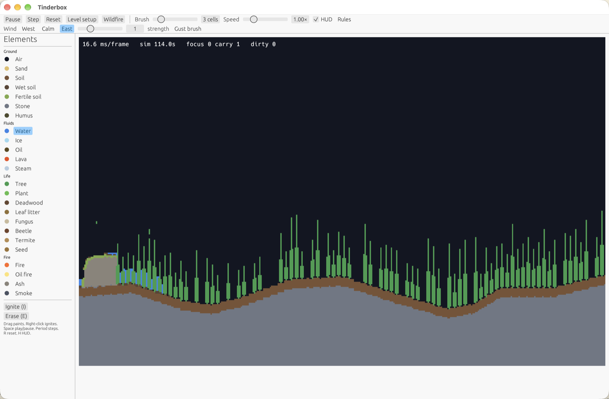

# Tinderbox

Tinderbox is a native falling-element sandbox built to be played, not measured. Set a fire in a forest, pour water into the flames, and watch wind carry ash and smoke while soil, seeds, decomposers, ice, oil, lava, and wooden boats make a changing ecology.




## Run

Install Rust with `rustup`, then start the native app:

```sh
cargo run --release -p tinderbox-app
```

By default the world fits the visible canvas at 3.5 logical points per cell; use the **Cell size** control to zoom between 2 and 8 points per cell. Native runs open in a 1360 × 860 window, and browser worlds use the canvas size. Resizing the app grows or crops the grid without resetting existing cells; resize regeneration is debounced by 120 ms and newly exposed terrain comes from the same level seed. The app starts in **Level setup**: choose a preset, terrain, seed, starting wind and element amounts; the world preview regenerates after edits settle, before you press **Play level**. Open setup again from the toolbar at any time; **Cancel / return to game** restores the paused world, and **Wildfire** starts the dry-forest preset at the current size. See [Level recipes](docs/levels.md) for generators, human-readable save/load and sharing. Native runs accept `--world-size=WIDTHxHEIGHT` as an explicit initial-size override. Use `--level recipe.toml` to start directly from a saved level recipe. For reproducible native scene captures, pass `--level recipe.toml --capture-at-seconds 20 --screenshot scene.png`; the capture stops when the simulation reaches the requested whole second (`0` captures the initial recipe). `--capture-after FRAMES` remains available when frame-based capture is preferred. Run `cargo run --release -p tinderbox-app -- --smooth-play` for a 900-frame native heavy-play check; use `--smooth-play --world-size=1024x640` to check the larger grid. Both runs report simulation and texture-upload caps, average frame interval, and worst frame interval.

## Play in the browser

The same sandbox is at <https://akofink.com/tinderbox/>. It uses WebGPU when the browser provides it, and WebGL2 otherwise. There is no local disk: open **Rules** and use **Download rules**, **Upload rules**, or **Stored rules**. Download saves the current tuned rules file, upload validates and applies a file you pick, and stored rules reloads the last valid copy from this browser. Dropping a text file onto the page also validates and applies it. Invalid imports keep the running rules unchanged.

## Play

- Choose an element from the left palette. Ground, fluids, life, and fire are grouped, with readable names such as Wet soil.
- Left-click or drag on the world to paint. The brush size is adjustable in the toolbar. **Place wooden boat** stamps a small rigid hull on air or water; paint sand beside it to load it. Nearby water current and wind nudge the whole hull together.
- Right-click to ignite at the pointer. Choose **Erase** or press `E` to paint air.
- **Pause/Play** or press `Space`; **Step** or press `.`; **Reset** or press `R` returns to the applied level's original seed and settings.
- **Level setup** pauses the game for editing and live-previews terrain, fit-to-canvas or advanced explicit size, seed, preset, atmosphere, wind, and material amounts. The Level setup and Rules panels can be moved by their title bars and resized. On native desktop a recipe loaded from a file also reloads when the file changes. **Cancel / return to game** restores the exact prior world and run state. Presets: **Dry forest, east wind**, **Island**, **Sandstorm valley**, **Boat lake**, and **Density lab**.
- Setup's **Save / load level (TOML)** saves and loads recipes by path on desktop, downloads/uploads and remembers them in a browser, and exports/imports copyable text everywhere. Set ambient temperature, humidity, oxygen, and a wooden boat with optional sand cargo or a burning hull. Set oxygen to 0% for an airless level. New ruleset elements automatically appear as amount sliders.
- Adjust simulation speed from 0.25× to 4×. Set wind to **West**, **Calm**, or **East** on the toolbar's second row; select **Gust brush** and drag across the world to apply a local burst. Wind drifts ash, smoke, and steam and speeds fire spread downwind.
- **Dry forest, east wind** starts with one spark on the west side, so the fire is a front you can watch and douse rather than an instant inferno.
- **Boat lake** uses a sealed stone lake to compare an empty, lightly loaded, overloaded, and burning hull in a steady east wind. **Density lab** uses a sealed near-freezing basin to demonstrate floating ice, sinking sand, steam, and burning oil.
- Water wets soil; ash and water make fertile soil and wake fungi. Fungus colonizes damp organic matter and moist soil, spreading faster in humid, cool air and fading when local food runs out. Beetles and termites crawl across supported ground, seek food, and flee fire or water; beetles favor leaf litter and humus while termites favor deadwood. Decomposers turn meals into fertile soil and follow their configured lifetimes and breeding chance. Burned trees drop seeds, which sprout faster on fertile soil. Plants and trees also age into leaf litter or deadwood and release seeds. The default tree lifetime is 60,000 cell updates, and generated forest cohorts start at deterministically varied lifecycle ages to stagger canopy turnover; seeds can germinate on deadwood as well as fertile soil. Dry litter burns readily and mixes with ash into humus.
- The coarse, fixed-rate atmosphere carries temperature, humidity, pressure, and oxygen. Moist air forms drifting clouds that soften at the edges and darken as droplets gather; clouds release scattered rain that wets soil, feeds puddles, and can damp fires. Dry air keeps a clear sky. Rain and surface water can evaporate back into vapor, while condensation draws down humidity so weather stays water-bounded. Hot water, steam, and fire plumes feed local convection and can seed clouds. Moisture and burn progress are compact per-cell attributes, so wood and dry litter do not need duplicate wet/dry elements. Boats use capped body IDs on ordinary wood cells, whole-body displaced-water buoyancy scaled by wood, cargo, and water densities, and a fixed-step bob; each atomic group translation is charged against the work budget. This body-level buoyancy stays separate from per-cell movement. Movable materials also use per-element density: sand sinks through water, gases bubble upward, and lighter ice, wood, or oil can rise, while static ground stays fixed. Once away from active flames, blocked ash rolls down one-cell diagonals, sliding off static ledges into angle-of-repose piles. Wind and an asymmetric-neighbor current nudge the hull, while fire detaches burned planks into loose material. Configured trees, plants, deadwood, leaf litter, and humus equilibrate toward local humidity; wet materials ignite and spread fire less readily. The Rules panel tunes which elements carry moisture, their humidity-equilibration rate, wet flammability, and oxygen consumption/diffusion. Fire consumes local oxygen and smothers when it is exhausted; oxygen diffuses and is replenished toward the level's ambient setting. Fire and lava warm the air; water and ice cool it. Warm water evaporates into steam, cool humid air condenses into clouds and dew, and cloud droplets fall as rain. Rain and dew hydrate soil and sustain regrowth. Temperature thresholds control freezing, melting, boiling, and heat ignition; pressure gradients drive local wind and rising convection alongside global wind.
- Choose **Temperature**, **Humidity**, **Pressure**, **Oxygen**, **Material moisture**, or **Burn progress** in the toolbar's **Overlay** menu to inspect atmospheric fields and per-cell attributes; choose Off to return to element colors. Ice melts near fire or lava. Lava ignites plants and turns water into stone and steam. Oil floats on water and burns quickly as bright, hot oil fire.
- Toggle the frame/simulation/pending-work HUD with **HUD** or `H`. **Ignite** or press `I` selects fire for painting.
- **Rules** opens the live physics panel. Toggle any interaction and adjust its chance without restarting the world.

## Rules and development

The default human-editable element, interaction, atmosphere, and ecology definitions are in `crates/sim/rules/default.toml`. Every element has a relative density (air is 100); lower-density movable elements rise through denser movable neighbors, and denser elements sink through lighter ones with a small per-pair chance. Static materials do not move. Density, wind response, interaction downwind bonuses, and ecology rates for critter movement, fleeing, breeding, and fungal climate response are editable in the Rules panel and serialized in rules TOML. The **Rules** panel groups interactions (Fire, Life, Fluids, Ground) and labels the change, for example "Tree becomes fire". Chance is a base probability per neighboring-cell visit, not per second; wind can add a downwind bonus. Disabled rules retain their tuned chance; they never fire, even with wind.

Use **Reset rules to defaults** to restore the shipped physics without resetting the world. On native desktop, **Save file** and **Load file** use the entered path (relative to the app's working directory or absolute). Saved TOML includes all element definitions, tuned chances, and enabled states. The **Rules TOML (copy/paste)** section also exports and applies editable text. Invalid files display an error and leave the current rules and cells unchanged. Successful loads remap existing cells and the selected brush by element name; elements removed by the loaded file become air. Sandbox shortcuts do not fire while typing in the panel.

Rules validate names, references, motion types, probabilities, atmospheric phase thresholds and rates, ecology settings, and unknown fields; a live ruleset must define `air`. The Rules panel tunes freezing, melting, boiling, ignition, heat transfer, evaporation, condensation humidity, and pressure-driven wind. Old files without `enabled` keep every interaction enabled. The headless simulation API provides `World::set_interaction`, atomic `World::load_rules`, `World::reset_rules`, and `Rules::to_toml`. The simulation crate has no window, graphics, or wall-clock dependency and can run in headless tests.

```sh
cargo fmt --all --check
cargo clippy --workspace --all-targets -- -D warnings
cargo test --workspace
```

## Lineage

Tinderbox reuses and adapts ideas from [Cascade](https://github.com/akofink/cascade-game-demo), including bounded simulation work with carry-over, preallocated scheduler storage, dirty-region texture uploads under a per-frame cap, a headless core, and the winit/wgpu/egui native stack. The project is independently licensed under MIT and has no dependency on Cascade crates.

## License

MIT. See [LICENSE](LICENSE).
