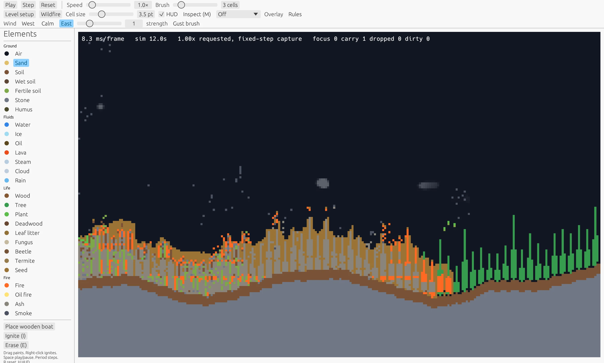
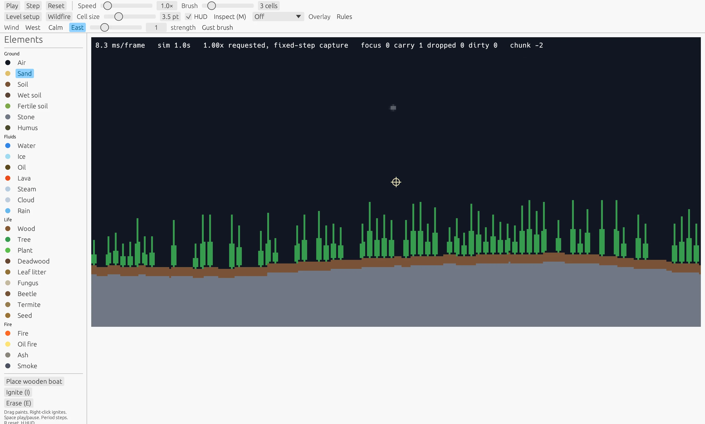
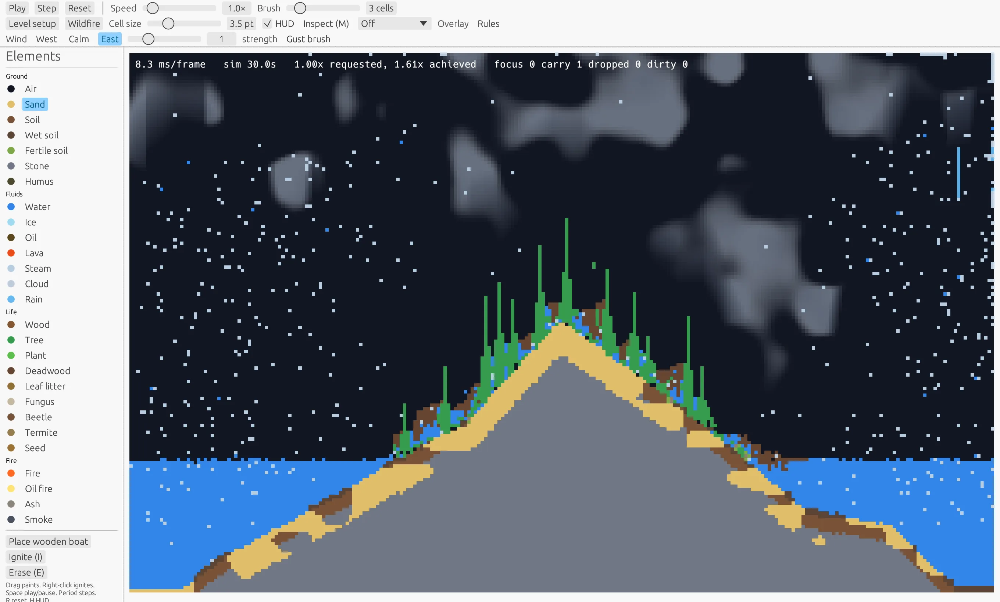
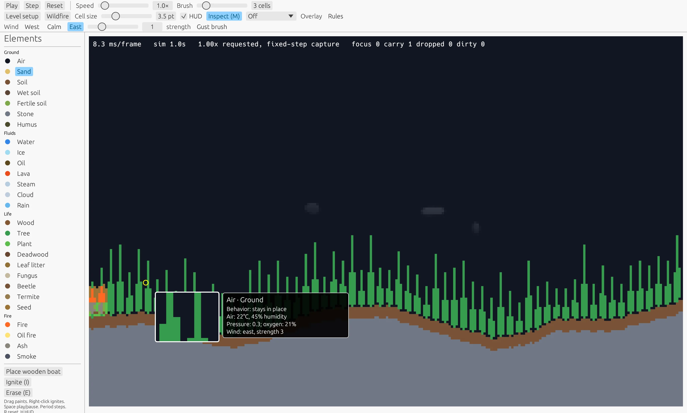
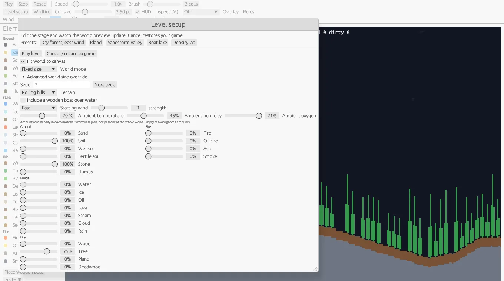
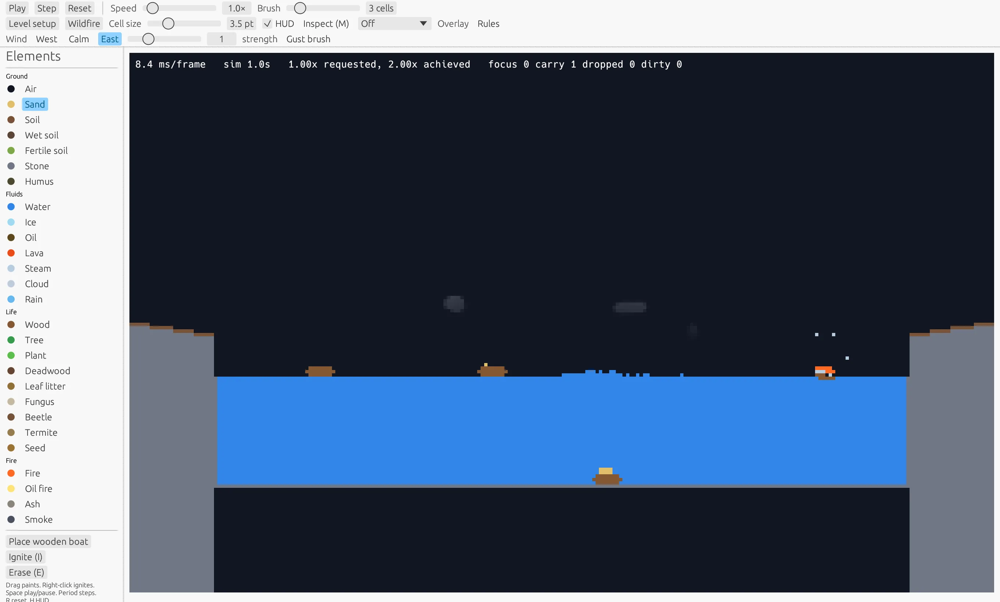

# Tinderbox

A living falling-element sandbox where fire, wind, weather, and ecosystems reshape every world.

## [Play in your browser](https://akofink.com/tinderbox/)



*East wind carries a fire front into standing trees.*


## Screenshots

| Endless world | Weather |
| --- | --- |
| <br>Hills and forest at chunk −1, with east wind selected. | <br>Clouds and rain cross a wooded island. |
| Inspector | Level setup |
| <br>The magnifier and tooltip show a cell and its local atmosphere. | <br>Choose a preset, shape terrain, and tune wind and materials. |
| Boats | |
| <br>Four boats share a lake; one has a burning hull. | |

## Run locally

Install Rust with `rustup`, then launch the native game:

```sh
cargo run --release -p tinderbox-app
```

For browser builds, scripted captures, flags, and testing, see [Capture and testing](docs/capture-and-testing.md). See [Level recipes](docs/levels.md) for presets and saving, loading, and sharing worlds.

## Play

- Choose a preset or build a level, then paint materials into the world. Fixed and endless worlds are available.
- Set wind, inspect cells with the magnifier, open the live Rules panel, or speed the simulation up to 10×.
- Watch clouds, rain, fire, water, plants, trees, fungi, and critters interact. Build and load custom levels in the browser, or save and load tuned rules there.

## Lineage

Tinderbox reuses and adapts ideas from [Cascade](https://github.com/akofink/cascade-game-demo), including bounded simulation work with carry-over, preallocated scheduler storage, dirty-region texture uploads under a per-frame cap, a headless core, and the winit/wgpu/egui native stack. It is independently licensed under MIT and has no dependency on Cascade crates.

## License

MIT. See [LICENSE](LICENSE).
